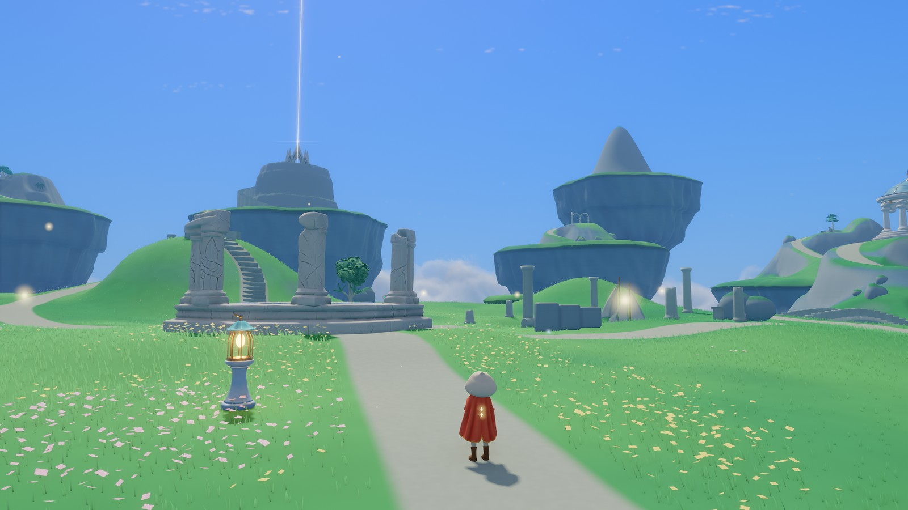

<p align="center">
  
</p>

<h1 align="center">Quench</h1>

<p align="center">
  A game engine designed for making games entirely with AI coding agents.<br>
  Version 0.12.1 · macOS and iOS · MIT
</p>

## Make your game with AI agents

You describe the game; an AI coding agent builds it on Quench, runs it, looks at the result and checks it. You play,
look and listen.

- **A new game in one command.** `tools/new_game.py` sets up a game project that builds and runs right away.
- **A skill for the agent.** Every game comes with the [quench-game](.agents/skills/quench-game/SKILL.md) skill: how
  to build a game on Quench, module by module, with working code.
- **Rules for the agent.** Every game has its own `AGENTS.md` and a devlog: how the agent works on the game, and a
  record of what it did.
- **The agent sees its own game.** Scripted scenarios run the game without a window, take screenshots the agent looks
  at and compares with reference images, and measure frame times.

## Made with Quench

[**Cloudsong**](https://github.com/m-brtn/cloudsong) is a calm exploration game among floating islands. Follow
flower-lined paths, discover old ruins and glide above the clouds, with animated characters and flowing cloth.

<p align="center">
  <a href="https://github.com/m-brtn/cloudsong">
    
  </a>
</p>

## What it can do

- **Graphics:** physically based materials, cascaded sun shadows, sky and atmosphere, fog, bloom, ACES and AgX tone
  mapping, TAA, HDR displays; your own render passes and surface shaders in HLSL.
- **Ray tracing** on Apple GPUs: shadows, ambient occlusion, reflections, global illumination, a path tracer,
  denoisers and MetalFX upscaling.
- **Lights and materials:** rect, disk and tube area lights with soft shadows, brushed metal, glass with tinted
  shadows, cut-outs.
- **Weather:** volumetric clouds that drift with the wind and change shape, from fair-weather cumulus to storm
  clouds and overcast, a single shower in a blue sky, cloud shadows on the ground, light that dims and greys under
  them, sunsets; rain that falls only under raining clouds, dry under roofs, shafts of rain in the distance and a
  rainbow, ground that gets wet and dries again, puddles with rings of drops, and a rain sound you can replace;
  snow when the air is cold, with fluttering flakes, a white cover on open ground that builds up and melts away,
  and white snow showers in the distance; wind with gusts that sweep through the rain and snow, grass and trees
  that sway in it and a wind sound; thunderstorms with lightning that lights up the clouds and thunder that rolls in
  later the farther it struck.
- **Particles and trails:** sparks, smoke, dust, fireflies and twinkling fields of light that drift in the wind and
  glow, and glowing ribbons behind moving things that fade toward the tail and shed sparkles.
- **Physics:** Jolt Physics, multithreaded on the engine's job system; wind that pushes the bodies you choose.
- **Sound:** 3D sound with HRTF for headphones, reverb, buses and mixing, streamed music with crossfades; WAV, FLAC,
  MP3 and Ogg Vorbis.
- **Animation:** blend trees and blend spaces, state machines, layers, IK and foot placement, look-at, root motion,
  retargeting, blend shapes, GPU skinning.
- **Navigation:** Recast & Detour navmeshes built in the background or cooked ahead, costly areas, jumps and ladders,
  moving obstacles, crowds that walk around each other.
- **Assets:** a build-time cooker for glTF models and images (BC7 on the Mac, ASTC on the iPhone, or Basis Universal
  for every device, transcoded at load time), loading in the background, streaming, hot reload.
- **Input and UI:** keyboard, mouse, gamepad and touch through named actions; Dear ImGui for tools.
- **Testing:** scripted scenarios, runs without a window, screenshot comparison, frame time and memory measurements.
- **Profiling:** Tracy zones on the CPU and the GPU for the engine and your game, recorded from a scripted run into
  a table of where the frame's time goes.
- **Platforms:** macOS and iOS, where a game can lower its frame rate and resolution as the phone heats up;
  Windows, Linux, Android and the web are planned.

## Getting started

Quench and its games are C++20 and build on a Mac with Xcode, CMake 3.28 or newer, Ninja and Python 3. The first
configure downloads the dependencies (a few minutes).

```sh
git clone https://github.com/m-brtn/Quench.git && cd Quench
python3 tools/new_game.py "My Game" ../my-game    # a new game, built and started once
```

Then open `../my-game` in your AI coding agent and describe the game you want.

To see what the engine can do, build and run the demo:

```sh
cmake --preset release && cmake --build --preset release
build/release/examples/demo/quench-demo
```

iPhone builds, the architecture and every module are in the [documentation](docs/README.md); what comes next is on the
[roadmap](docs/roadmap.md#what-is-next).

Built on SDL3, Metal, Jolt Physics, Dear ImGui, GLM, enkiTS, meshoptimizer, Basis Universal, miniaudio, ozz-animation,
Recast & Detour and, for profiling, Tracy ([dependencies](docs/dependencies.md)).

## Licence

Quench is MIT licensed, see [LICENSE](LICENSE). Third-party libraries and data keep their own licences, collected in
[THIRD_PARTY_LICENSES](THIRD_PARTY_LICENSES).
