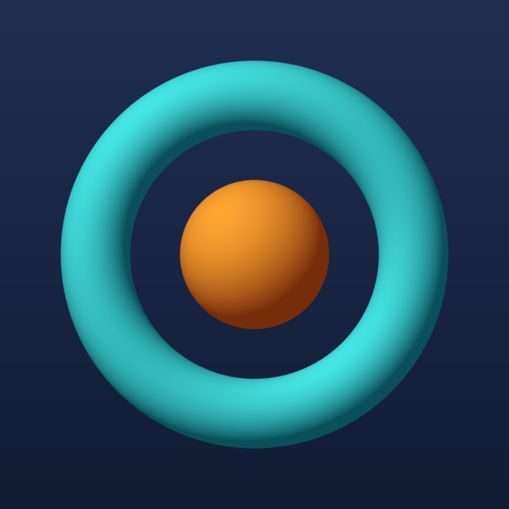
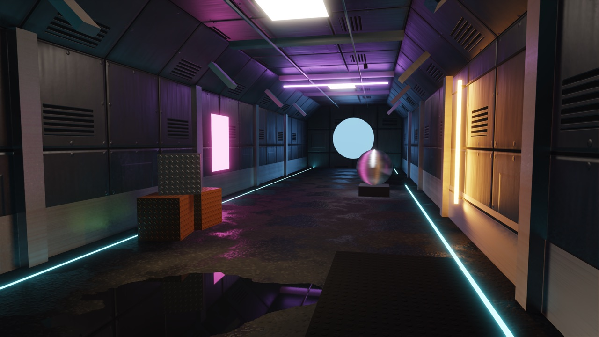
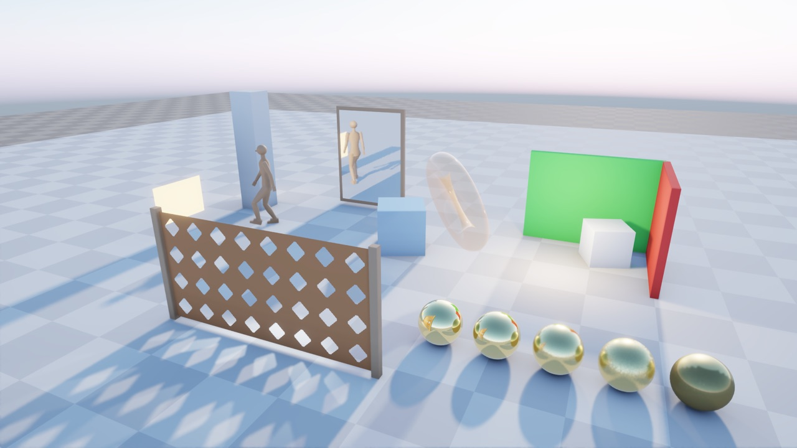
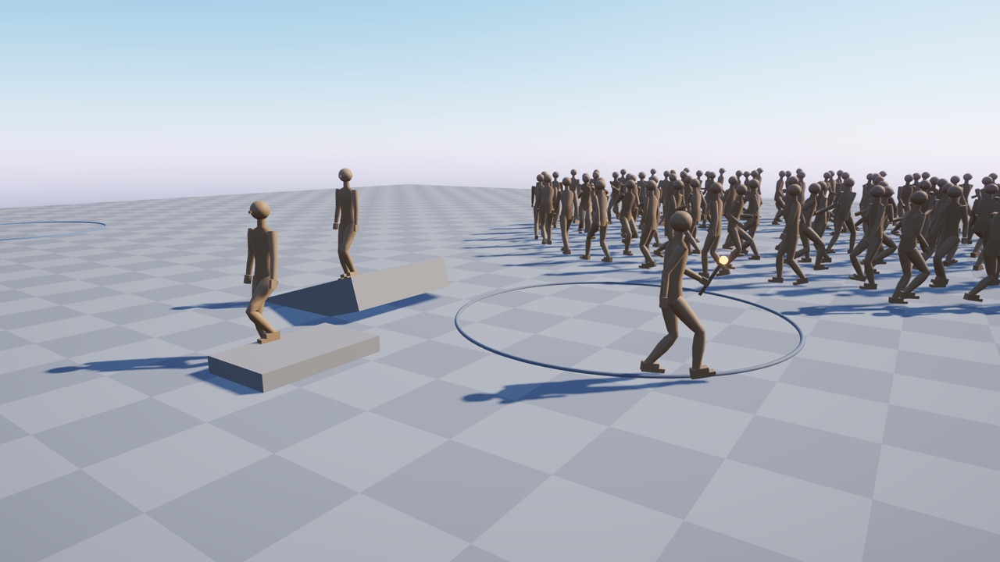

<p align="center">
  
</p>

<h1 align="center">Quench</h1>

<p align="center">
  A game engine designed for making games entirely with AI coding agents.<br>
  Version 0.10.0, early · macOS and iOS · MIT
</p>

## Games made by AI agents

Quench is designed for making games entirely with AI coding agents. A person describes the game; agents build it on
the engine, run it, look at it and check it; the person plays, looks and listens. What lets an agent do the whole
loop here:

- **A game starts in one command:** `python3 tools/new_game.py "My Game" ../my-game` copies the template, pins the
  engine, builds the game and starts it once.
- **The [quench-game](.agents/skills/quench-game/SKILL.md) agent skill comes with every game.** It tells an agent how
  to build a game on the engine, module by module, with working code. In its first dry run (2026-11-07) an agent
  built a small game from the skill alone: a lit scene, physics, sound, input and a scenario with a capture.
- **Each game gets its own `AGENTS.md` and devlog** from the template: the agents' rules and a record of what was
  done and verified, like the engine's [AGENTS.md](AGENTS.md) and [devlog](devlog/).
- **An agent can see and check its own work without a person:** scripted scenarios and offscreen runs, captures it
  can look at and golden images to compare them with, perf regions with GPU timings, headless tests, and `--help` on
  every app.
- **The person does what needs a person:** plays, looks and listens. The demo's check mode lists those checks.

It is early work, and it does not make a game without effort: what the game should be, and whether it is good,
stays with the person.

<p align="center">
  
</p>
<p align="center">
  
  
</p>

<p align="center"><sub>
  The engine demo on the native Metal backend on a Mac, captured offscreen; all content is procedural.
  Top: rect, disk and tube area lights with soft ray-traced shadows, traced reflections in the puddle, brushed
  aluminium (anisotropic GGX), MetalFX upscaling. Left: ray-traced sun shadows through a cut-out fence, reflections
  in a mirror and gold spheres, light bounced by a probe grid. Right: a crowd of 96 updated on the job system, foot
  placement on a ramp and a step, a torch held in a hand.
</sub></p>

## What it can do

**Rendering**
- A retained scene: meshes, materials, instances and lights registered by handle
- PBR materials with normal, metallic-roughness and emissive maps; cut-out and translucent surfaces
- Cascaded sun shadows, with holes from cut-outs and tinted by glass
- Sky and atmosphere, height fog, bloom, ACES or AgX tone mapping, TAA or FXAA
- Game render passes and surface shaders; one HLSL source compiled at build time for every backend
- Shader hot reload on the Mac
- Effects chosen by device capability, each with a fallback and its reason; optional shadow maps for spot and point
  lights, GTAO and SSR

**Ray tracing and MetalFX** (on Apple GPUs through the native Metal backend, opt-in; the default is SDL GPU)
- Soft ray-traced shadows of the sun and of up to 4 local lights, ambient occlusion
- Reflections; indirect light from a probe grid (DDGI-like) or per-pixel rays
- The engine's temporal and spatial denoisers
- MetalFX spatial and temporal upscaling and denoising
- A reference path tracer
- Acceleration structures refitted as instances move and skin; GPU time per pass

**Area lights and materials**
- Rect, disk and tube lights (LTC shading), their shapes drawn in the scene
- Soft ray-traced area light shadows, sampled by the path tracer too; unshadowed without ray tracing
- Anisotropic GGX for brushed metal

**HDR output**
- HDR display output up to the display's headroom, read every frame on Apple platforms
- The UI at paper white, SDR captures; looked at on an iPhone, not yet on a Mac HDR display

**Physics**
- Jolt Physics, its jobs on the engine's job system
- A fixed 120 Hz step, rendered interpolated

**Sound** (checked by measurement and offline mixes; not yet listened to)
- A 48 kHz stereo float mixer with buses, volume, mute, pause and meters
- 3D sound with Doppler and voice stealing; HRTF for headphones
- Reverb buses with per-sound sends
- Streamed music with crossfades; sounds the game generates
- WAV, FLAC, MP3 and Ogg Vorbis; output through miniaudio

**Animation** (on ozz-animation; checked by numbers and still captures)
- Blend trees, 2D blend spaces, state machines with cross-fades
- Masked and additive layers, events, root motion
- Two-bone and aim IK, look-at, foot placement, attachments
- Retargeting onto other skeletons at cook time, blend shapes with weights from clips
- GPU skinning, linear or dual quaternion
- A parallel update on the job system, animation LOD by screen size

**Assets**
- A build-time cooker for glTF, GLB, PNG, JPEG and KTX2: BC7 textures on desktops, ASTC in iOS builds
- Models with tangents, skins and blend shapes; skeletons, clips and sounds
- Loads on jobs with placeholders, a cache with budgets, streaming by distance
- Hot reload on the Mac and, in development builds, on a device

**Jobs**
- A job system on enkiTS: one thread pool for physics, animation and asset loads
- Also runs on a single thread, as the web needs

**Input and UI**
- The engine owns the main loop; a game implements one interface
- Named input actions over keyboard, mouse, gamepad and touch
- Dear ImGui for tools and diagnostics
- macOS apps and iOS bundles from one CMake call

**Automated testing and captures**
- One CTest test per case, labelled by module
- Offscreen scripted scenarios: input, camera, checks of values, captures
- Golden captures per GPU backend, compared by an image diff with thresholds
- Perf regions: frame, CPU and GPU times, memory footprint, thermal state
- Sanitizers, an iPhone test app, gates sized to the change (`tools/check.sh`)
- An engine demo with a section per feature, each with a scripted check and golden captures

**Platforms:** macOS and iOS today; Windows, Linux, Android and the web are planned. The headless modules also run as
WebAssembly under Node.js.

## Getting started

The engine and its games are C++20; they build on a Mac with Xcode and its command line tools, CMake 3.28 or newer,
Ninja and Python 3. The first configure downloads the pinned dependencies and builds the shader compiler for ray
tracing once (a few minutes).

```sh
cmake --preset release && cmake --build --preset release
ctest --preset release -j8                                     # the tests
build/release/examples/demo/quench-demo                        # the engine demo
build/release/examples/demo/quench-demo --gpu-backend metal    # with ray tracing and MetalFX
python3 tools/new_game.py "My Game" ../my-game                 # a new game from the template
```

Everything else (iOS and iPhone builds, the other presets, the architecture, every module) is in the
[documentation](docs/README.md); what comes next is on the [roadmap](docs/roadmap.md#what-is-next).

Built on SDL3, SDL GPU and Metal, Jolt Physics, Dear ImGui, GLM, enkiTS, meshoptimizer, miniaudio and ozz-animation
([dependencies](docs/dependencies.md)).

## Licence

Quench is MIT licensed, see [LICENSE](LICENSE). Third-party libraries and data keep their own licences, collected in
[THIRD_PARTY_LICENSES](THIRD_PARTY_LICENSES).
